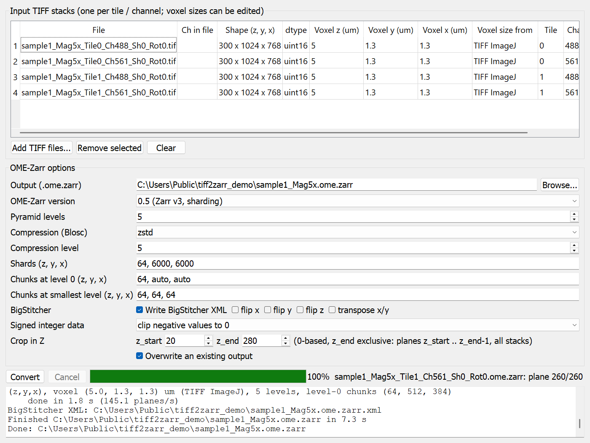

TIFF to OME-Zarr Converter
==========================

The **TIFF to OME-Zarr** converter turns one or more TIFF stacks — for example
the tiles and channels of an acquisition saved as TIFF — into a single
`OME-Zarr <https://ngff.openmicroscopy.org/>`_ container with multi-resolution
pyramids, plus a BigStitcher XML. It uses the same pyramid writer as the
``MP_OME_Zarr_Writer`` plugin (see :doc:`file_formats`), so the output has the
same layout as an OME-Zarr acquisition.

It is not limited to mesoSPIM data: any TIFF that ``tifffile`` can read works,
including ImageJ hyperstacks, OME-TIFF and ScanImage stacks.

The tool is a single module (``mesoSPIM/src/utils/tiff_to_omezarr.py``) with a
command-line interface and an options window.

   Four mesoSPIM tiles (2 tiles × 2 channels) converted with the default
   options and cropped to planes 20–279. The table shows the voxel size found
   in each file and where it came from, and the tile and channel each stack
   was assigned to.

Launching the tool
------------------

From mesoSPIM-control
~~~~~~~~~~~~~~~~~~~~~

Open **Utils → Convert TIFF stacks to OME-Zarr** in the Main window. As with
the :doc:`PSF <psf_analysis>` and :doc:`field curvature <field_curvature>`
tools, the window runs as a **separate OS process**, so a long conversion never
blocks the microscope GUI. Its file dialogs start in the current acquisition
folder.

From the command line
~~~~~~~~~~~~~~~~~~~~~

The converter does not need the microscope software to be running. With input
files and no ``--gui`` it converts directly and prints progress; without input
files, or with ``--gui``, it opens the window (with the files listed).

.. code-block:: bash

   # options window
   python mesoSPIM/src/utils/tiff_to_omezarr.py

   # convert all tiles of a sample into one container
   python mesoSPIM/src/utils/tiff_to_omezarr.py D:/data/sample1_*.tif -o D:/data/sample1.ome.zarr

   # keep planes 100-399 only, 4 pyramid levels, lighter compression
   python mesoSPIM/src/utils/tiff_to_omezarr.py stack.tif --z-start 100 --z-end 400 --levels 4 --compression-level 3

   # all options
   python mesoSPIM/src/utils/tiff_to_omezarr.py --help

Without ``-o``, the output is written next to the first input file, named after it.

Output layout
-------------

.. code-block:: text

   sample1.ome.zarr/                     container (Zarr group, no image of its own)
       zarr.json                         lists each image's source file, voxel size and z range
       Tile0_Ch488.ome.zarr/  or  <stack name>.ome.zarr/
           0/ 1/ 2/ 3/ 4/                pyramid levels, full resolution first
       ...
   sample1.ome.zarr.xml                  BigStitcher project

One multiscale image is written per stack, and per channel for multichannel files.

.. important::

   **Open the image folder, not the container.** Viewers such as AGAVE, napari
   or Fiji need the inner ``<image>.ome.zarr`` folder, which holds the OME
   multiscales metadata. The top-level container has none, and AGAVE reports
   *No attributes.ome found in zarr.json* for it. BigStitcher opens the whole
   project through the ``.ome.zarr.xml``.

Each image folder is named after its TIFF file. If that would make any output
file path longer than 240 characters, the converter uses short names
(``Tile0_Ch488.ome.zarr``) and logs it. Windows limits paths to 260 characters
for programs that do not opt in to long paths. Python does, but AGAVE 1.9, for
example, does not, and reports a missing ``zarr.json`` on longer paths. The
container's ``zarr.json`` records which TIFF each image came from.

Voxel size
----------

The voxel size of every TIFF is kept and written into the OME-Zarr scale
metadata and the BigStitcher XML. It is read, in this order, from:

1. **the TIFF itself** — OME-XML ``PhysicalSizeX/Y/Z``; or the
   ``XResolution``/``YResolution`` tags (ImageJ unit, centimetre or inch)
   together with the ImageJ ``spacing`` (z step); or the ScanImage metadata
   (z step from ``SI.hStackManager``, XY from the imaging field of view if the
   resolution tags are missing);
2. **the mesoSPIM metadata file** ``<file>_meta.txt`` next to the TIFF
   (``Pixelsize in um``, ``z_stepsize``);
3. **your input** — ``--voxel-size z,y,x`` on the command line (used only for
   files without a voxel size), or the voxel size cells of the table, which can
   also override a value found in the file.

The *Voxel size from* column shows which source was used. A file whose voxel
size is still unknown is not converted: the cell turns red and the conversion
stops with a message, rather than writing a wrong physical scale.

Tiles, channels and positions
-----------------------------

Each stack's tile, channel, illumination side and angle come from the mesoSPIM
metadata file when there is one (stage position, laser, shutter, rotation).
Otherwise they come from the file name (``Tile3``, ``Ch488`` or ``488nm``,
``Sh0`` / ``Left`` / ``Right``, ``Rot0``), and a file matching none of these
counts as a tile of its own. Multichannel TIFFs, such as an ImageJ ``ZCYX``
hyperstack or a ScanImage stack with several saved channels, are split into
one image per channel.

Stage positions from the metadata file become the OME-Zarr ``translation`` and
the BigStitcher tile positions, so tiles open roughly in place. Use the
**flip x/y/z** and **transpose x/y** options if the tile arrangement comes out
mirrored or rotated in BigStitcher. They work as in the ``MP_OME_Zarr_Writer``
(see :doc:`file_formats`).

Planes are written exactly as stored in the TIFF: the converter does not
rotate or flip the image data.

Options
-------

.. list-table::
   :header-rows: 1
   :widths: 22 22 56

   * - Option (window / CLI)
     - Default
     - Meaning
   * - OME-Zarr version / ``--ome-version``
     - ``0.5``
     - ``0.5`` = Zarr v3 with sharding; ``0.4`` = Zarr v2, no sharding (for older viewers).
   * - Pyramid levels / ``--levels``
     - ``5``
     - Number of resolution levels, including full resolution. Fewer are written
       if the stack is too small (the smallest level stays at least 16 px).
       Levels first halve only XY until the XY pixel size reaches the z step,
       then halve all three axes.
   * - Compression / ``--compression``, ``--compression-level``
     - ``zstd``, ``5``
     - Blosc codec (``zstd``, ``lz4`` or ``none``) and level 1–9.
   * - Shards / ``--shards``
     - ``64, 6000, 6000``
     - Maximum shard size (z, y, x), ``none`` for no sharding; 0.5 only. Shard z
       must equal the level-0 chunk z.
   * - Chunks at level 0 / ``--base-chunks``
     - ``64, auto, auto``
     - Chunk size (z, y, x) at full resolution. ``auto`` (y and x) picks the exact
       divisor of the plane size closest to 512: 5056 → 632, 2960 → 592,
       2048 → 512. The chunks then tile the plane with no partial chunk at
       the edge. If no divisor lies between 256 and 1024 (e.g. a prime size),
       the axis is split into near-equal parts instead.
   * - Chunks at smallest level / ``--target-chunks``
     - ``64, 64, 64``
     - Chunk size the levels shrink towards.
   * - Write BigStitcher XML / ``--no-xml``
     - on
     - Writes ``<output>.ome.zarr.xml`` (OME-Zarr 0.4 and 0.5).
   * - Signed integer data / ``--signed-integers``
     - ``clip``
     - The writer stores uint16. For signed TIFFs (e.g. ScanImage ``int16`` after
       offset subtraction): ``clip`` sets negative values to 0 and logs how many;
       ``shift`` adds 32768 (lossless, values change); ``error`` stops on
       negative values. ``uint8`` is widened to ``uint16``; float TIFFs are not
       supported.
   * - Crop in Z / ``--z-start``, ``--z-end``
     - all planes
     - Keep planes ``z_start`` … ``z_end − 1`` of every stack (0-based, ``z_end``
       exclusive, as in Python; ``end`` in the window means up to the last plane).
       The z translation is shifted by ``z_start × z step``, so cropped stacks keep
       their physical position. Fiji numbers planes from 1: Fiji slice 101 is
       ``z_start`` 100.
   * - Overwrite / ``--overwrite``
     - off
     - Replace an existing output container. The window asks first.

The defaults follow the sharded 12 FPS acquisition settings in
``config/examples/user/config_benchtop-cDAQ-ASI_user-shardedZARR-12FPS-continuos.py``,
with zstd level 5 instead of 1 (an offline conversion is not time-critical)
and ``auto`` level-0 chunks.

Performance
-----------

Conversion is usually limited by disk speed. Uncompressed TIFFs are
memory-mapped and read plane by plane, so memory use stays small whatever the
stack size. A 535-plane 512 × 512 ScanImage stack read from a network share
converts in about 3 s, and a 1024 × 768 mesoSPIM tile at about 150 planes/s
on a local SSD.
