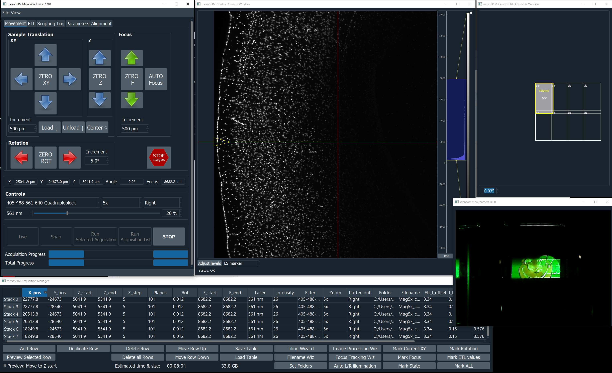
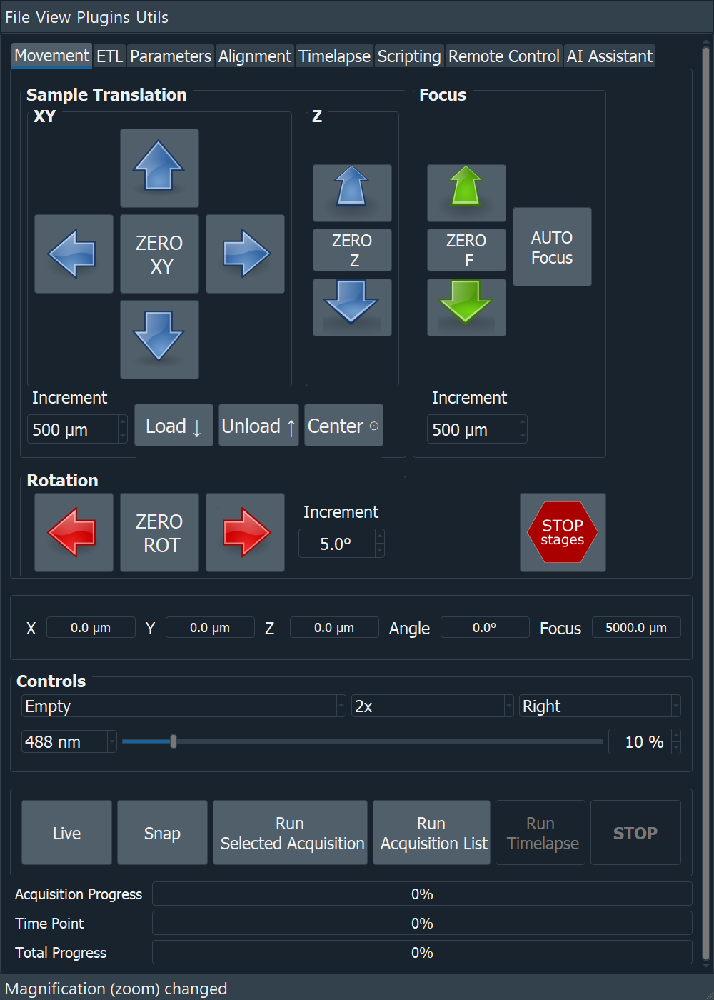

User Guide
==========

This guide walks you through the mesoSPIM-control GUI and its core workflows —
from moving a sample to running a fully automated tiled acquisition.

Overview of the interface
--------------------------

   **mesoSPIM-control v1.9** — Main window (left), Camera live view (centre),
   and Acquisition Manager (right).

The application has five main windows:

.. list-table::
   :widths: 25 75
   :header-rows: 1

   * - Window
     - Purpose
   * - **Main window**
     - Stage position read-out, manual motion controls, laser/shutter
       selection, and single-image snap.
   * - **Camera window**
     - Live camera preview with auto-range intensity scaling.
   * - **Acquisition Manager**
     - Build, edit, and run multi-position / multi-channel acquisition lists.
   * - **Tile overview window**
     - Overview of tile positions and overlaps.
   * - **Webcam window**
     - Optional USB webcam feed for sample monitoring (configurable in
       ``ui_options``).

Main window
-----------

   Main window (Movement tab): menu bar, mode tabs, stage controls, position
   read-out, illumination controls, and acquisition/progress controls.

The tabs, from left to right: **Movement**, **ETL**, **Waveforms**,
**Other** (alignment modes, contrast window, snap directory, display subsampling), **Timelapse** (see :doc:`timelapse`), **Scripting**,
**Remote Control** (see :doc:`remote_control/index`) and **AI Assistant**
(see :doc:`ai_assistant/index`). The position read-out, the Controls box and
the Live / Snap / Run / STOP buttons below the tabs stay visible on every tab,
and stretch with the window.

Stage controls
~~~~~~~~~~~~~~

The ``X / Y / Z / F / θ`` buttons move the corresponding axis by the step
size shown in the adjacent spin box.  Button polarity and step-motion delays
are configurable in the :doc:`configuration` file (``flip_XYZFT_button_polarity``,
``button_sleep_ms_xyzft``).

.. note::

   The **F axis** controls the focus/objective position.  If your setup uses a
   revolving objective turret, set ``enable_f_zero_button: False`` in the
   config to prevent accidental mechanical conflicts.

Shutter and laser selection
~~~~~~~~~~~~~~~~~~~~~~~~~~~

* Use the **shutter drop-down** to choose Left, Right, or Both illumination
  arms.
* Select the active **laser** from the wavelength drop-down.  Only lasers
  listed in ``laserdict`` will appear.

Waveform viewer (Waveforms tab)
~~~~~~~~~~~~~~~~~~~~~~~~~~~~~~~

**Show waveforms** opens a window with the output waveforms of one sweep on a
common time axis (0 to the sweep time, in ms): galvos L/R, ETLs L/R, the active
laser, the camera trigger and, for ASI or mixed stages, the stage trigger.  The
plots share the time axis, so zooming into one zooms all.  While the window is
open it refreshes twice a second, so changes on the Waveforms and ETL tabs show
up right away.  It only displays the current waveforms; nothing is sent to the
hardware.  The arm not selected by the shutter setting is shown flat at its
offset, as it is output.

Channel settings (ETL tab)
~~~~~~~~~~~~~~~~~~~~~~~~~~

The **channel settings file** (formerly *ETL config file*, ``startup['ETL_cfg_file']``)
stores, for every laser line and zoom (magnification), the ETL offsets and
amplitudes and, optionally, the **absolute focus (F) position**.  It is a
semicolon-separated CSV file:

.. code-block:: text

   Objective;Wavelength;Zoom;ETL-Left-Offset;ETL-Left-Amp;ETL-Right-Offset;ETL-Right-Amp;F-Absolute-um
   1x;488 nm;2x;2.31;0.70;2.36;0.65;5012.5
   1x;561 nm;2x;2.29;0.71;2.35;0.64;

* **Choose channel settings file** loads a file.  Old ETL files without the
  ``F-Absolute-um`` column load unchanged; an empty cell means "no F stored".
* **Save channel settings** writes the ETL parameters *and the current F
  position* of the current laser and zoom.  Old files get the F column on the
  first save.
* F is stored in **physical stage coordinates** (not affected by zeroing F),
  so stored positions stay valid after the F axis is zeroed.

**Load F positions** checkbox (default from ``startup['load_f_from_channel_file']``,
off if not set): when ticked, every time the channel settings are loaded
(laser, zoom or file change), the stored F of that channel is checked:

* missing F, F more than **500 µm** away from the current F, or F outside the
  stage limits: a warning is shown and logged, and **F does not move**;
* otherwise a dialog asks *Move focus (F)?* with the current and stored F and
  the distance.  F moves only if you click **Yes** (No is the default).  The
  checks are repeated just before the move; if laser, zoom, file or F changed
  meanwhile, or the microscope started an acquisition, F does not move.
  The same offer (same channel, file, stored and current F) is not asked twice
  in a row; choosing a file or toggling the checkbox asks again.

The demo configs use ``config/etl_parameters/channel-parameters.csv``, which
has F positions for all demo lasers and zooms near the demo start F (5000 µm).

Stored F positions are never used during acquisitions, previews, scripts or
tiling: acquisition rows keep their own F values.  When the checkbox is off,
F values in channel settings files are ignored.

Camera window
-------------

The live view updates continuously when a laser and shutter are open.
Right-click the histogram to set intensity levels; the **Auto** button fits
the display to the current frame.

Acquisition Manager
-------------------

Building an acquisition list
~~~~~~~~~~~~~~~~~~~~~~~~~~~~~

Each row in the Acquisition Manager table represents one
**acquisition entry** — a combination of position (X, Y, Z, F, θ),
illumination (laser, filter, shutter), and file settings.

Common workflow:

1. Move the sample to the desired start position using the Main window.
2. Select the laser, shutter, filter settings for the acquisition entry.  The live view
   will update to reflect the current settings, so you can preview before
   acquiring.
3. Click **Add Row** to create a new entry in the Acquisition Manager, or use the first entry to overwrite it.
4. Click **Mark ALL** to copy the current stage coordinates and light-sheet settings to the entry.  Alternatively, use the **Mark ..** buttons to mark individual parameters (eg XY position).
5. Click small **M** button next to **Z start / Z end / Z step** values to mark the positions and step for a Z-stack. Small **M** button appears always on the right side of the cell that is being manipulated.
6. Choose the **laser**, **filter**, and **shutter** arm.
7. Enter the **filename** using the **Filename Wizard**.
8. Repeat for additional positions or channels.
9. For a tiled (mosaic) acquisition, use the **Tiling Wizard** to populate the Acquisition Manager.

Grouping rows
~~~~~~~~~~~~~

For lists with many rows, three toggle buttons collapse the table into logical groups so that
related rows can be reviewed and edited together:

.. list-table::
   :widths: 30 70
   :header-rows: 1

   * - Button
     - Groups rows by
   * - **Group by Laser**
     - Illumination laser (channel).
   * - **Group by Illumination**
     - Illumination side (Left / Right).
   * - **Group Selected**
     - The currently selected rows, regardless of their settings.

Each group is collapsed under a header showing the group key and row count. Editing a value on
the visible row of a group applies that edit to every other row in the group. Click the same
button again to ungroup.

.. raw:: html

   <video controls loop muted playsinline width="100%">
     <source src="AcqManagerGrouping.mp4" type="video/mp4">
     Your browser does not support embedded video.
     <a href="AcqManagerGrouping.gif">View the animation as a GIF instead</a>.
   </video>

*Grouping Acquisition Manager rows by selection, laser, and illumination.*

Acquisition modes
~~~~~~~~~~~~~~~~~

.. list-table::
   :widths: 30 70
   :header-rows: 1

   * - Mode
     - Description
   * - **Live**
     - Live mode (preview).
   * - **Snap**
     - Single image with current settings.
   * - **Run selected acquisition**
     - Sweeps the sample from *Z start* to *Z end* in *Z step* increments while illuminating with the light-sheet, using the stage coordinates and light-sheet settings from the Acquisition Manager entry.
   * - **Run Run Acquisition list**
     - Takes all stacks defined in the Acquisition Manager sequentially; this can combine multiple XY positions into a mosaic (see the **Tile Overview window** to plan overlap) and loop through multiple channels and illumination settings.
   * - **Time-lapse**
     - Repeats the entire acquisition list at defined time intervals. Configured
       from its own **Timelapse** tab — see :doc:`timelapse` for setup, timing
       model, and progress indicators.

Output file formats
~~~~~~~~~~~~~~~~~~~~

Select the image writer for each acquisition entry in the file-naming
wizard. Writers are part of the mesoSPIM plugin system; see
:doc:`file_formats` for a full comparison (extensions, pyramids,
compression, downstream compatibility) and configuration examples.

Processor chain
~~~~~~~~~~~~~~~~

Image processors modify frames before they are shown in live view and before
the same processed data is written to disk. They are configured from
**Plugins → Processor Chain** — see :doc:`image_processors` for the built-in
processors, the Processor Chain window, and GPU acceleration notes. For
plugin-author details, see :doc:`plugins`.

Plugins and Utils menus
~~~~~~~~~~~~~~~~~~~~~~~~

The Main window menu bar also has:

* **Plugins → Processor Chain** — opens the processor-chain window described
  above.
* **Utils → PSF (beads) analysis from a stack** — launches the
  :doc:`Bead PSF Analysis <psf_analysis>` tool, preloaded with the most
  recently completed acquisition or a chosen TIFF file.
* **Utils → Field curvature / chromatic shift from Z-stacks** — launches the
  :doc:`Field Curvature & Chromatic Shift <field_curvature>` tool for
  measuring field flatness and axial chromatic aberration from z-stacks of a
  Ronchi grating.

Running an acquisition
~~~~~~~~~~~~~~~~~~~~~~

Click **Run Acquisition List** in the Main Window to start.  Progress is shown
in the status bar and log.  To stop mid-acquisition click **Stop**.

Script window
-------------

The script window exposes the full mesoSPIM Python API.  Scripts run in the
same process and can read/write the instrument state, move stages, snap
images, and iterate over acquisition lists.

A selection of example scripts is in ``mesoSPIM/scripts/``.

Logging and troubleshooting
----------------------------

* All session output is logged to a timestamped file in ``mesoSPIM/log/``,
  e.g. ``20241210-154845.log``.
* Set ``logging_level = 'DEBUG'`` in your config for ultra-verbose output.
* For live status, watch the terminal where you launched the software.

Further resources
-----------------

* `ZMB Dozuki guides <https://zmb.dozuki.com/c/Lightsheet_microscopy#Section_MesoSPIM>`_
  — start-up, setup, and acquisition walkthroughs.
* `mesoSPIM YouTube channel <https://www.youtube.com/c/mesoSPIM>`_
* `image.sc user forum <https://forum.image.sc/tag/mesospim>`_
